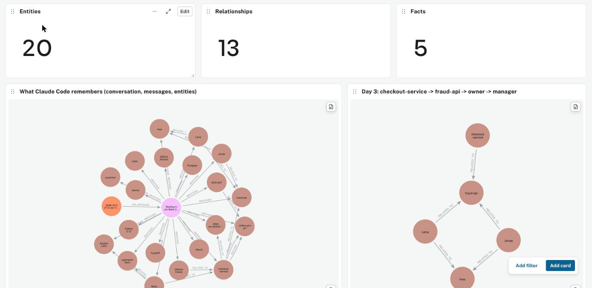
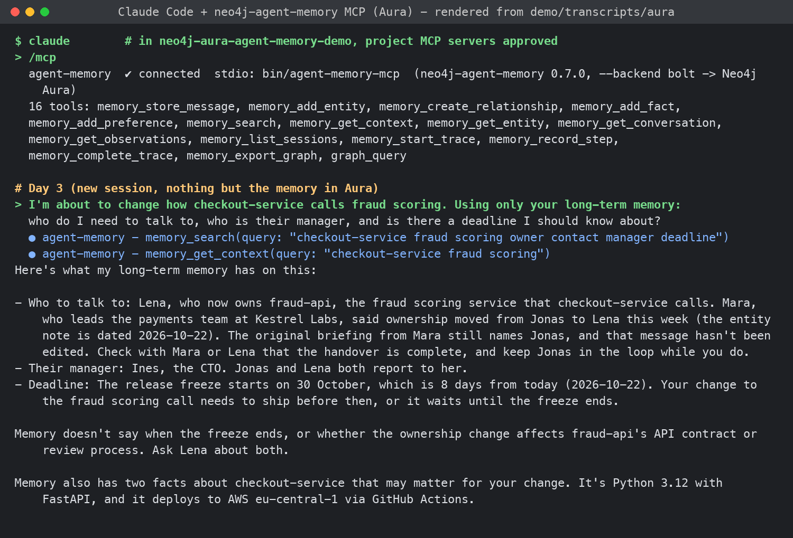
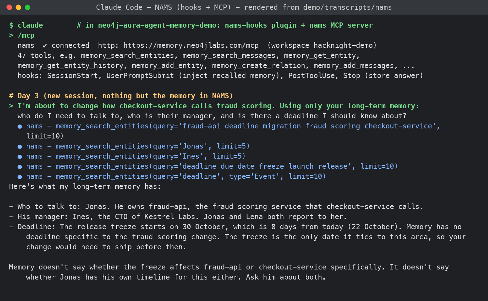
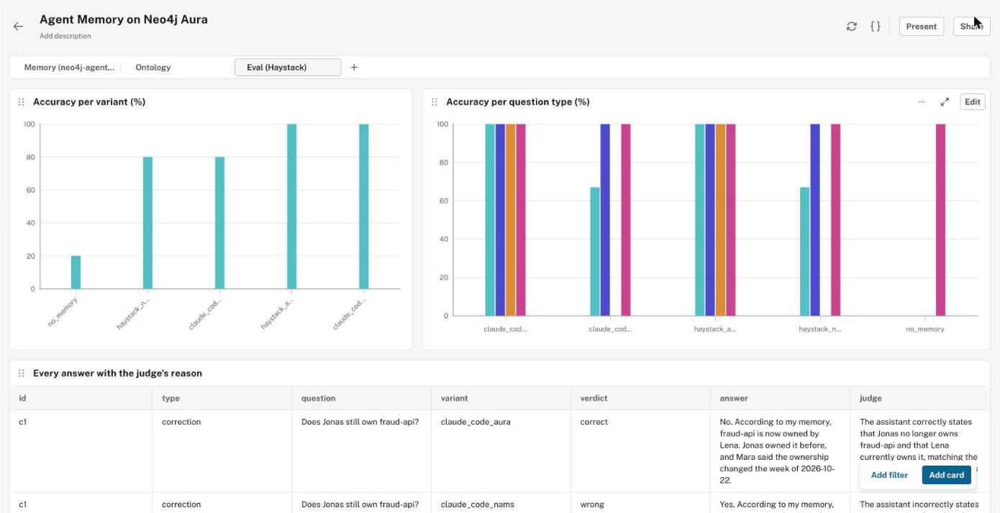
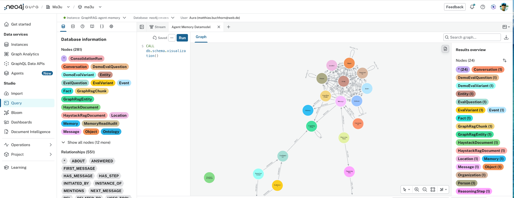
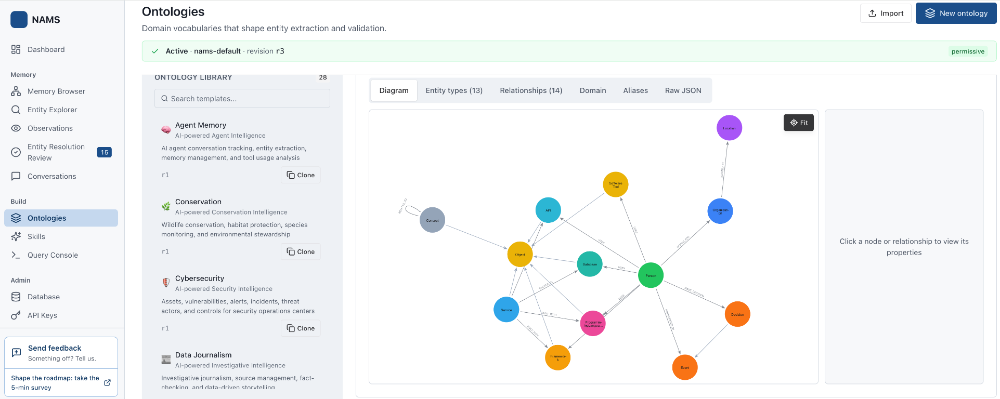
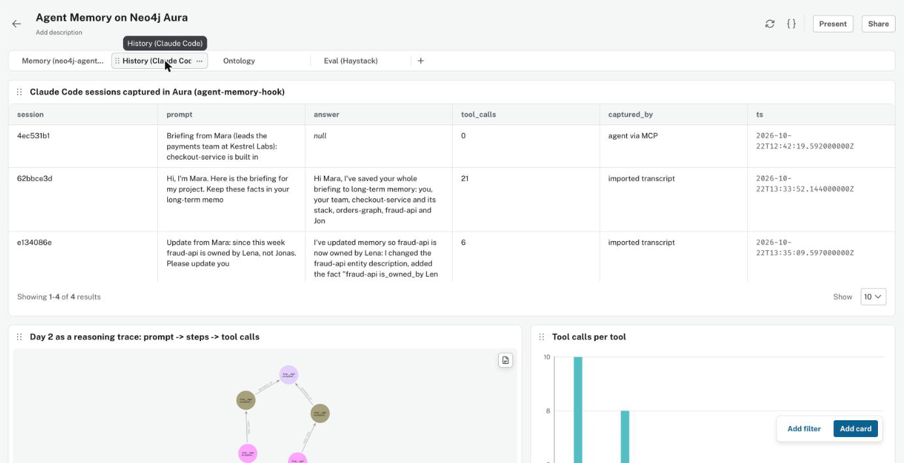
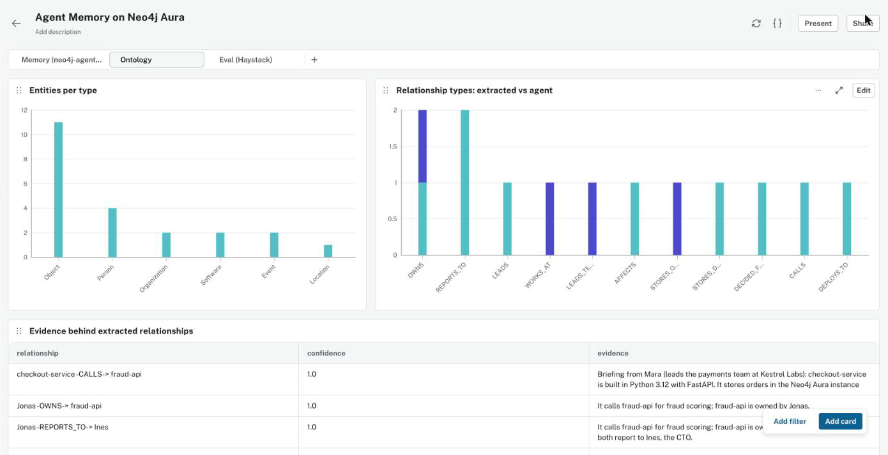
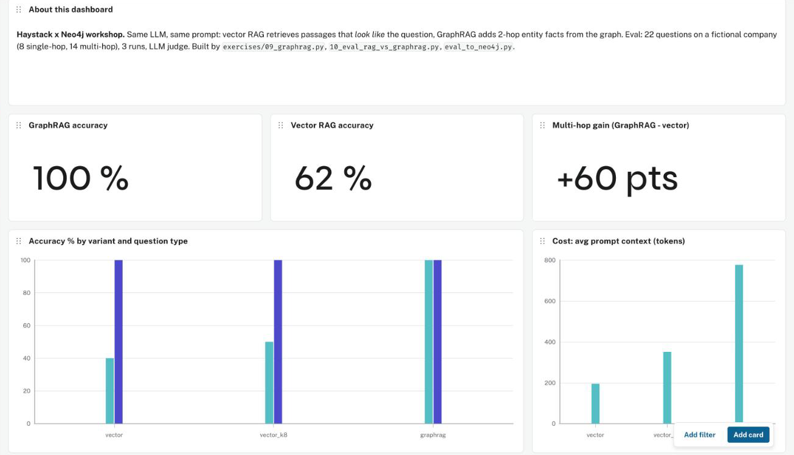

<!-- markdownlint-configure-file { "MD033": { "allowed_elements": ["details", "summary", "img"] } } -->

# Neo4j Agent Memory for Claude Code, Antigravity and GitHub Copilot

Hacknight demo for [**Graphs Gone Wild**](https://globalai.community/e/ack9t53d) (NODES 2026 pop-up, Global AI Berlin,
23 October 2026).

Your coding agent starts a new chat. Does it still know who owns a service, why the team made a decision, and which
deadline matters? This demo stores that knowledge in Neo4j so another session, or another agent, can retrieve it.

**Two ways to do it:** run the **neo4j-agent-memory SDK and its MCP server yourself**, or connect to the hosted
**Neo4j Agent Memory Service (NAMS)**. Both store graph memory in Neo4j. The choice is how much you want to manage.

**Start here:** [Choose a solution](#choose-a-solution) · [Connect your agent](#connect-your-agent) ·
[See the results](#final-results-what-to-take-away) · [Understand the story](#the-story) ·
[Engineering notes](#what-we-learned-building-it).

## Get the code

[](https://github.com/ma3u/neo4j-aura-agent-memory-demo)
Scan or open the [GitHub repository](https://github.com/ma3u/neo4j-aura-agent-memory-demo) for the code and setup guides.

## Choose a solution

### Option 1: neo4j-agent-memory on your Aura instance

**Choose this when you want control over the memory pipeline and direct access to the graph.**

[`neo4j-agent-memory`](https://neo4j.com/labs/agent-memory/) is an open-source SDK. In this demo, its MCP server runs
on your machine, extracts entities using your configured model, and writes to your Neo4j Aura database over Bolt.
Aura manages the database; **you run the memory server and configure its models**.

```text
Your coding agent -> local SDK MCP server -> your Neo4j Aura database
```

It fits a team that already uses Aura, wants memory next to application data, needs structured facts with validity
dates, or wants to customize extraction, embeddings and application-specific graph queries. The tradeoff is more
setup: Python dependencies, credentials, model configuration and SDK maintenance are your responsibility.

**Start with:** [Set up the SDK on Aura](docs/setup-aura.md).

**Official details:** [Self-hosted MCP tools and server profiles](https://neo4j.com/labs/agent-memory/reference/mcp-tools/)
and [Bolt/NAMS capabilities and data scope](https://neo4j.com/labs/agent-memory/reference/backend-capabilities/).

### Option 2: NAMS, the hosted memory service

**Choose this when you want to connect agents without operating the memory server or extraction workers.**

[NAMS](https://memory.neo4jlabs.com) provides a workspace, hosted MCP endpoint, background processing and a console
for inspecting memory and reviewing extracted entities. The workspace can use service-managed Neo4j storage or a
supported bring-your-own database. **NAMS runs the memory service either way.**

```text
Your coding agent -> hosted NAMS MCP server -> workspace Neo4j database
```

It fits a team trying persistent memory for the first time, connecting several MCP-capable clients, or preferring a
workspace UI over maintaining a local extraction pipeline. The tradeoff is dependence on the service's available
operations, processing behavior, access scopes and current workspace limits. It does not expose every Bolt SDK feature.

**Start with:** [Set up a NAMS workspace](docs/setup-nams.md).

**Official details:** [Hosted NAMS OAuth and API-key authentication](https://neo4j.com/labs/agent-memory/reference/nams-mcp/#_authentication)
and [API keys, workspaces and access scopes](https://neo4j.com/labs/agent-memory/reference/authentication/).

### Which should I use?

| Your priority | Choose | Why |
| --- | --- | --- |
| Get started without running a memory server | **NAMS** | Hosted MCP, extraction workers and workspace UI. |
| Control extraction models and embeddings | **SDK on Aura** | Configure the pipeline in your own process. |
| Use direct graph writes or structured facts | **SDK on Aura** | Bolt offers operations unavailable through the NAMS Python wrappers. |
| Share a hosted memory workspace across clients | **NAMS** | Connect clients to the same authorized workspace. |
| Extend an application that already uses your Aura graph | **SDK on Aura** | Integrate memory with your own graph and queries. |
| Keep your database but outsource memory processing | **NAMS with a supported external database** | Database ownership and memory-service operation are separate choices. |

**Recommendation:** start with **NAMS** for a managed experience. Choose **SDK on Aura** when you have a concrete
need for its additional control or Bolt capabilities. The SDK can also access NAMS; these are deployment choices,
not competing database engines ([official backend capabilities](https://neo4j.com/labs/agent-memory/reference/backend-capabilities/)).

Neither option makes corrections automatically reliable. Define how old claims are superseded, and test what the
agent retrieves. Also check current costs and data-handling requirements: this demo has no cost benchmark, a
configured external extraction model receives text, and using your own database with NAMS still uses its service.
Both offerings are Neo4j Labs projects; do not assume a production support SLA.

Both demo paths use **one ontology**, a vocabulary defining the allowed entity types and relationships
([ontology/](ontology/)). MCP gives the agent memory tools such as search and store. **Hooks are separate:** they
capture conversations automatically. Connecting an MCP server alone does not record every prompt and answer.
For access-control details, read the official [identity and retrieval scope reference](https://neo4j.com/labs/agent-memory/reference/backend-capabilities/#scope).

## Connect your agent

The steps are the same in principle: **prepare a backend, connect its MCP server, then verify a real tool call**.
You do not need both backends. The repository includes configurations for both so you can compare them.

### First, prepare your chosen backend

| Choice | Prepare once | Server name used below |
| --- | --- | --- |
| SDK on Aura | Follow [the Aura setup](docs/setup-aura.md): create the Python `venv`, install dependencies, and set Aura/model credentials in the gitignored `.env`. The launcher uses the shared ontology. | `agent-memory` |
| Hosted NAMS | Follow [the NAMS setup](docs/setup-nams.md): create a workspace and activate the demo ontology. Use OAuth for a supported interactive HTTP client, or an API key for the local proxy. | `nams` |

The hosted HTTP connection does not require a local Python memory server. Python is needed for this demo's scripts
and for the optional NAMS stdio proxy. Never put passwords or API keys in the shared MCP JSON.
The SDK's [transport reference](https://neo4j.com/labs/agent-memory/reference/mcp-tools/#_transports) explains local
stdio versus network HTTP; these are connection methods, separate from the database backend.

Choose your client: [Claude Code](#claude-code) · [Antigravity](#antigravity-local-preview) ·
[GitHub Copilot](#github-copilot).

### Claude Code

1. **Open this repository in Claude Code.** Its project configuration is already in [.mcp.json](.mcp.json).
2. **Approve the project MCP configuration.** Use `/mcp` to see the available servers.
3. **Select your backend.** Start `agent-memory` for the SDK/Aura option. For NAMS, select `nams`, choose
   **Authenticate**, complete browser sign-in and select the intended workspace.
4. **Test retrieval.** Use the [read-only test prompt](#check-that-memory-is-really-used) below and inspect the actual
   MCP tool response. A plausible answer alone is not a connection test.
5. **Add automatic capture when you need it.** For Aura, this repo's [.claude/settings.json](.claude/settings.json)
   wires [bin/agent-memory-hook](bin/agent-memory-hook). For NAMS, install/configure the optional `nams-hooks` plugin
   using [the NAMS hook instructions](docs/setup-nams.md#step-4-connect-claude-code). Keep only the intended capture
   backend active when comparing solutions.

**What is verified:** the published demo used Claude Code to write memory and evaluated fresh Claude Code sessions
reading it. The MCP server supplies tools; the capture hooks are a separate integration.

**Official details:** [Project-scoped MCP configuration](https://code.claude.com/docs/en/mcp#project-scope),
[local stdio servers](https://code.claude.com/docs/en/mcp#option-3-add-a-local-stdio-server),
[remote OAuth sign-in](https://code.claude.com/docs/en/mcp#authenticate-with-remote-mcp-servers), and
[hook configuration locations](https://code.claude.com/docs/en/hooks#hook-locations).

### Antigravity (local preview)

**Status:** the local Antigravity adapter and NAMS proxy are still uncommitted working-tree changes, not a released
integration. A fresh clone of the published revision does not yet contain the complete adapter. Native IDE
autodiscovery has not been verified.

1. **Prepare your backend.** Aura uses the same `.env` and SDK launcher as Claude Code. For the local NAMS proxy,
   also set `NAMS_API_KEY` in `.env`.
2. **Add the selected server to the host's MCP configuration.** Use the matching entry from
   [.agents/mcp_config.json](.agents/mcp_config.json): `agent-memory` launches [bin/agent-memory-mcp](bin/agent-memory-mcp),
   while `nams` launches [bin/nams-mcp](bin/nams-mcp). Both use stdio, a local process connection.
3. **Start the host inside this repository.** The supplied definitions locate the launchers with
   `git rev-parse --show-toplevel`. The NAMS proxy reads its key locally and connects to the hosted service; it
   does not need an interactive OAuth flow. Do not assume the host discovers the project file automatically.
4. **Enable capture only if the host supports the supplied hook events.** Register
   [.agents/hooks.json](.agents/hooks.json) and set `AGENT_MEMORY_HOOKS_BACKEND=aura` or `nams` in the host environment.
   Both groups are enabled in the file, so explicitly select one backend.
5. **Test retrieval.** Use the shared [read-only test prompt](#check-that-memory-is-really-used) and inspect the tool
   call. Verify an actual IDE session separately from the headless protocol adapter.

**Official native-client details:** [MCP setup by Antigravity surface](https://antigravity.google/docs/mcp/#getting-started-by-surface),
[MCP configuration fields](https://antigravity.google/docs/mcp/#mcp-configuration-structure),
[supported hook events](https://antigravity.google/docs/hooks/#supported-events), and
[PreInvocation context injection](https://antigravity.google/docs/hooks/#preinvocation).
These describe Antigravity itself; they do not establish that this demo's adapter has passed a native IDE run.

<details>
<summary>Antigravity adapter commands and capture behavior</summary>

The local runner uses a **Haystack agent over MCP** and emits Antigravity-shaped hook payloads. It tests the adapter
protocol, not the Antigravity application's own agent runtime. Google's
[native SDK MCP guide](https://antigravity.google/docs/sdk/mcp/) documents a separate programmatic integration.
To exercise the local adapter:

```bash
venv/bin/python demo/run_sessions.py --backend aura --harness antigravity
venv/bin/python demo/run_sessions.py --backend nams --harness antigravity
```

These commands write story memory and replace the corresponding backend transcripts. The local runner defaults to
`antigravity`; pass `--harness claude` for the Claude Code path. The local evaluator adds `antigravity_aura` and
`antigravity_nams` and changes its default variant list; these are separate from the saved results below.

The hooks handle `SessionStart`, `PreInvocation`, `PostToolUse` and `Stop`. Before the first invocation of a turn,
they inject recalled memory as an ephemeral message; they also capture prompts, tool activity and final answers.
The shared daemon handles persistence. Set `AGENT_MEMORY_HOOKS=0` to disable capture during evaluation. The Claude
Code `nams-hooks` plugin is not needed by this adapter. Implementation: [harness/claude_backends.py](harness/claude_backends.py).

</details>

### GitHub Copilot

1. **Open this repository.** Native Copilot uses the portable [.mcp.json](.mcp.json), whose top-level object is
   `mcpServers`. It already contains `agent-memory` and `nams`.
2. **Check native discovery, if the Copilot CLI is installed.** Run these from the repository root:

   ```bash
   copilot mcp list
   copilot mcp get agent-memory
   ```

3. **Enable your selected server in an agent session.** Review any trust prompt. For a supported NAMS HTTP client,
   complete browser OAuth and select the workspace when requested. VS Code local MCP tools use
   [.vscode/mcp.json](.vscode/mcp.json) instead; see the configuration note below if the server is missing.
4. **Test retrieval.** Use the shared [read-only test prompt](#check-that-memory-is-really-used). Expand the tool call
   and confirm that it came from the selected MCP server.

**What is verified:** native CLI discovery works. Separately, the configured Aura launcher exposed 16 tools and a
read-only search returned demo evidence. **A Copilot Chat tool call and VS Code picker visibility remain unconfirmed.**
No automatic Copilot session-capture hooks are installed; ask the agent to store information explicitly when needed.

**Official details:** [Repository-level Copilot MCP configuration](https://docs.github.com/en/copilot/how-tos/copilot-cli/customize-copilot/add-mcp-servers#adding-per-repository-mcp-servers),
[CLI server listing and inspection](https://docs.github.com/en/copilot/how-tos/copilot-cli/customize-copilot/add-mcp-servers#using-copilot-mcp-subcommands-from-the-terminal), and
[VS Code configuration destinations](https://code.visualstudio.com/docs/agent-customization/mcp-servers#_choose-a-configuration-destination).

<details>
<summary>Copilot Global, VS Code configuration and the missing-server issue</summary>

For a user-wide native configuration, choose **MCP: Add Server → Global → Copilot Global** in supported VS Code
versions, or merge this entry into `$COPILOT_HOME/mcp-config.json` (default `~/.copilot/mcp-config.json`). Replace the
example with the absolute path to your checkout and preserve any existing entries:

```json
{
  "mcpServers": {
    "agent-memory": {
      "type": "stdio",
      "command": "/absolute/path/to/neo4j-aura-agent-memory-demo/bin/agent-memory-mcp",
      "args": []
    }
  }
}
```

Run `copilot mcp list` and `copilot mcp get agent-memory` outside the checkout to verify the source is **User**,
rather than the workspace override. The launcher still reads this checkout's `.env`; keys do not belong in the JSON.

VS Code's workspace and user-profile MCP files use a different top-level key, **`servers`**. Eligible entries can be
forwarded to a Copilot harness, but **`code --add-mcp` writes the VS Code user profile, not Copilot Global**.

In the tested VS Code 1.142 window, **MCP: List Servers** showed only extension-provided servers despite valid
workspace/profile entries and a full reload. Native Copilot Global discovery was verified afterward with the CLI;
that does not establish that the VS Code picker is fixed. Do not keep adding duplicate configurations as proof of
success: verify a tool call in the intended client.

Official references: [Native Copilot user configuration](https://docs.github.com/en/copilot/how-tos/copilot-cli/customize-copilot/add-mcp-servers#editing-the-configuration-file),
[portable JSON format](https://code.visualstudio.com/docs/agents/reference/mcp-configuration#_portable-configuration),
[automatic discovery sources](https://code.visualstudio.com/docs/agents/reference/mcp-configuration#_automatic-mcp-server-discovery),
[the destination used by `code --add-mcp`](https://code.visualstudio.com/docs/agents/reference/mcp-configuration#_command-line-installation), and
[authentication and secret handling](https://code.visualstudio.com/docs/agents/reference/mcp-configuration#_authentication-and-secrets).

</details>

### Check that memory is really used

If you loaded the demo story, ask the following. Otherwise, ask about something you explicitly stored in your own
workspace. Replace `agent-memory` with `nams` when using the hosted backend:

```text
Use only the agent-memory MCP tools to find who owns fraud-api, who their manager is,
and when the release freeze starts. Report conflicting claims or missing information.
Do not read repository files, run shell commands, or write new memory.
```

Check that the intended server actually returned evidence. Missing facts should produce "I don't know", not a
guess. On this shared demo database, leave `graph_query` disabled: a raw database read could see evaluation answers.
During evaluation, also disable capture hooks so questions and answers do not become new memory.
VS Code's [first-tool-call verification checklist](https://code.visualstudio.com/docs/agent-customization/mcp-servers#_verify-the-first-tool-call)
shows how to distinguish a configured server from a working connection.

**Test status:** the published scores below cover Claude Code and Haystack, not Copilot or a native Antigravity IDE
run. Server discovery, successful retrieval and an end-to-end client integration are different levels of verification.

## Final results: what to take away

**Memory survived a fresh session and transferred between agents.** Claude Code wrote the project memory;
both Claude Code and a separate Haystack agent could then answer questions from it.

| Memory setup | Claude Code | Haystack | What the audience should notice |
| --- | --- | --- | --- |
| No memory | Not tested | **2/10 (20 %)** | Only the two deliberately unanswerable questions were correct. |
| SDK on our Aura instance | **10/10 (100 %)** | **10/10 (100 %)** | Recalled the project, the corrected owner and the manager; abstained on missing facts. |
| Hosted NAMS workspace | **8/10 (80 %)** | **8/10 (80 %)** | Recalled the project, but used the old owner in two answers affected by the same correction. |

**The lesson is not "Aura always beats NAMS".** This is one fictional story, 10 questions per variant and an LLM judge,
not a general benchmark. Both Aura ownership edges remained live: the successful answers used an updated description
and a dated fact, not automatic retirement of the old relationship. The demo shows that storing memory is useful;
retrieving all relevant memory and resolving conflicting updates are separate engineering tasks.



## The story

A fictional team (so no model can answer from pre-training), told to Claude Code over three days
([demo/story.json](demo/story.json); prompts never name a tool):

| Session | Mara says | Memory has to |
| --- | --- | --- |
| Day 1 | Briefing: payments team at Kestrel Labs, checkout-service (FastAPI, Aura `orders-graph`, eu-central-1), fraud-api owned by **Jonas**, Jonas and Lena report to Ines (CTO), ADR-007, release freeze 30 October | store it |
| Day 2 | "fraud-api is owned by **Lena** now, not Jonas" | update it |
| Day 3 | "I'm changing how checkout-service calls fraud scoring: who do I talk to, who is their manager, any deadline?" | answer with 2 hops + the correction: **Lena → Ines, freeze 30 October** |

Both backends keep the full Claude Code session history: `nams-hooks` for NAMS, [bin/agent-memory-hook](bin/agent-memory-hook)
for Aura (the SDK's MCP server alone stores only what the agent sends; the three demo sessions were imported from their
transcripts with [harness/import_transcripts.py](harness/import_transcripts.py)).

Each session is a fresh headless `claude -p` with **no** chat history, **no** Claude Code file memory and **no**
file/shell/web tools ([harness/claude_backends.py](harness/claude_backends.py)). Transcripts:
[demo/transcripts/aura](demo/transcripts/aura/), [demo/transcripts/nams](demo/transcripts/nams/).

| Day 3 on Aura (neo4j-agent-memory) | Day 3 on NAMS |
| --- | --- |
|  |  |

## Evaluation (Haystack)

<details>
<summary>Open the scoring method, per-question results and evaluation chart</summary>

[eval/eval_memory.py](eval/eval_memory.py): 10 questions ([eval/questions.json](eval/questions.json)): 4 single-hop,
3 multi-hop, 1 correction, 2 *not in memory* (the right answer is "I don't know"). An LLM judge (Haystack chat
generator, JSON mode) compares each answer with the reference. The Haystack agents read memory through the **same SDK**
for both backends ([harness/memory_tools.py](harness/memory_tools.py)): `MemorySettings(backend="bolt")` for Aura,
`backend="nams"` for NAMS. All eval runs are read-only (and the NAMS hooks are off, or every question would be stored).

| Variant | What answers | Memory |
| --- | --- | --- |
| `no_memory` | Haystack Agent, no tools | baseline |
| `haystack_aura` | Haystack Agent + neo4j-agent-memory (Bolt) | Aura, **written by Claude Code** |
| `claude_code_aura` | fresh `claude -p` + the SDK's MCP server (read tools) | Aura |
| `haystack_nams` | Haystack Agent + neo4j-agent-memory (NAMS backend) | NAMS, **written by Claude Code** |
| `claude_code_nams` | fresh `claude -p` + hosted NAMS MCP (read tools) | NAMS |

Results of the run in this repo (22 October 2026, one run per variant; Claude Sonnet for Claude Code, Azure OpenAI
gpt-5-mini for extraction, the Haystack agents and the judge):

| Variant | Overall | Single-hop (4) | Multi-hop (3) | Correction (1) | Not in memory (2) |
| --- | --- | --- | --- | --- | --- |
| `no_memory` | 20 % | 0 % | 0 % | 0 % | 100 % |
| `haystack_aura` | **100 %** | 100 % | 100 % | 100 % | 100 % |
| `claude_code_aura` | **100 %** | 100 % | 100 % | 100 % | 100 % |
| `haystack_nams` | 80 % | 100 % | 67 % | 0 % | 100 % |
| `claude_code_nams` | 80 % | 100 % | 67 % | 0 % | 100 % |

Both NAMS misses are the same story: *"who owns fraud-api?"* and *"does Jonas still own it?"* are answered with Jonas.
After the correction, NAMS holds `Lena OWNS fraud-api` **and** the original `Jonas OWNS fraud-api`, and the extracted
entity description still says "owned by Jonas"; the tools used in this run did not reconcile them. On Aura both
`OWNS` edges are live too, but the day-2 session rewrote the entity description and stored a fact with `valid_from`,
which is what the readers found. This compares two configured memory workflows, not identical write capabilities:
the [backend reference](https://neo4j.com/labs/agent-memory/reference/backend-capabilities/) documents structured facts
and direct relationship creation on Bolt, but not through the NAMS Python wrappers.

`haystack_aura` scored 80 % in the first run: the demo's Haystack tool searched entities and messages but not **facts**
(the freeze date and the ADR-007 reason were stored as facts). With `search_facts` added it scored 100 %. With 10
questions and one run, one answer is 10 points.



**Reading the evaluation chart:** the left chart has one light-blue accuracy bar per variant. In the saved chart on
the right, **light blue = multi-hop**, **dark blue = single-hop**, **orange = correction**, and **pink = not in memory**.
These colors identify question types, not Aura versus NAMS. A missing correction bar means **0 %**, not an untested
category; both NAMS variants have 2/3 multi-hop answers correct and 0/1 corrections correct.

After importing the three Claude Code sessions into Aura (prompts, answers, 30 tool calls) the two Aura variants were
rerun: still 100 %, and the eval left the memory untouched (hooks off, read-only tools).

Results go to Aura as `(:DemoEvalVariant)-[:ANSWERED {correct, answer, reason}]->(:DemoEvalQuestion)` and onto the
dashboard. Raw answers and judge reasons: [eval/results/eval_results.json](eval/results/eval_results.json).

</details>

## The graph and its vocabulary

### Aura: inspect what is stored



The supplied Aura screenshot runs **`CALL db.schema.visualization()`** on the shared `GraphRAG-agent-memory` instance.
It brings three kinds of records into view: conversations and messages; entities and facts; and recorded reasoning
steps, tool calls and tools. `HAS_MESSAGE` connects conversations to messages, `MENTIONS` connects messages to entities,
and `RELATED_TO` connects entities, with the domain relationship name (such as `OWNS`) stored in its `type` property.
These links make memory inspectable beyond the chat window. Recorded tool activity is an application trace, not the
model's hidden chain of thought ([official memory model](https://neo4j.com/labs/agent-memory/)).

**Read the counts carefully:** the sidebar reports **281 stored nodes and 551 relationships** for this database
snapshot; the **24 nodes** in the result are virtual schema nodes representing labels, not 24 project entities.
`HaystackDocument`, `GraphRagChunk` and evaluation labels appear because this database also holds workshop and test
data. This is not a memory-only count. Neo4j's
[procedure documentation](https://neo4j.com/docs/operations-manual/current/procedures/#procedure_db_schema_visualization)
also warns that the default statistics-based schema view can show relationship combinations absent from the data.
Use a targeted data query to verify a specific ownership edge.

### NAMS: configure what can be extracted



The supplied NAMS screenshot shows the ontology library on the left, a vocabulary diagram in the center, and a
property inspector on the right. The visible tabs list **13 entity types and 14 relationships**, including concepts
such as `Person`, `Service`, `Database`, `Organization` and `Decision`. Nodes here represent **types**, and arrows
represent declared relationship patterns, not the people and services remembered from our three sessions.
Node colors distinguish types; they are not the blue-bar provenance or accuracy encodings in the dashboard charts.

**Configuration matters:** the banner in this screenshot says **`nams-default`, revision `r3`, permissive**.
It illustrates the ontology UI, but does not show the demo's custom ontology activated. For the evaluated setup we
used [agent-memory-software-team.json](ontology/agent-memory-software-team.json); the separate
[activated custom-ontology screenshot](docs/screenshots/setup/nams-3-ontology-active.png) shows
`agent-memory-software-team`, revision `r1` (14 entity types, 29 relationships). Verify the active ontology in the
workspace used for a run. The [official ontology guide](https://neo4j.com/labs/agent-memory/explanation/ontologies/)
distinguishes templates, active versions and migration: changing a vocabulary does not by itself reconcile old claims.

## Aura dashboard

[dashboard/dashboard.cypher](dashboard/dashboard.cypher) → [dashboard/build_dashboard.py](dashboard/build_dashboard.py)
→ Aura console → Dashboards → Import. Live (project members):
**[Agent Memory on Neo4j Aura](https://console.neo4j.io/projects/326809f3-c351-4eb7-8770-fcf5d0b6adc1/studio/dashboards/yCfaWsVBltViYPw7jRcS)** and the workshop's
[Haystack GraphRAG on Neo4j](https://console.neo4j.io/projects/326809f3-c351-4eb7-8770-fcf5d0b6adc1/studio/dashboards/oZVFPdtMHufwLxAT7hbo).

| History page (Claude Code sessions) | Ontology page |
| --- | --- |
|  |  |

**Reading the ontology chart:** in "Relationship types: extracted vs agent", **light blue / turquoise = `extracted`**
(relationships with an `extractor` property), and **dark blue / indigo = `agent`** (no `extractor` property, treated as
direct agent writes in this demo). The vertical axis counts stored relationships, not accuracy or confidence.
For example, the saved `OWNS` bar contains one extracted edge and one agent-added edge: the original owner and the
correction coexist. The query classifies provenance from metadata; missing metadata is not a universal proof of an
agent write. See query **O2** in [dashboard/dashboard.cypher](dashboard/dashboard.cypher).

The workshop dashboard this demo builds on (GraphRAG vs. vector RAG on the same Aura instance):



## What we learned building it

<details>
<summary>Open eight implementation lessons checked against official documentation</summary>

Rechecked against the maintainers' documentation on **22 October 2026**, for **Python SDK 0.7.0**. Below, "observed"
means this demo's behavior, not a guarantee about every deployment. Both options are Neo4j Labs projects; the
[SDK documentation](https://neo4j.com/labs/agent-memory/) explicitly notes that Labs offers no support SLA or backwards
compatibility guarantee.

1. **An ontology must match the extracted types.** Observed: `fraud-api` landed as `:Entity:Object`; an `OWNS` pattern
   targeting only `Service` dropped the correction, while an additional `Object` pattern kept it
   ([our ontology notes](ontology/README.md)). The
   [official extraction guide](https://neo4j.com/labs/agent-memory/how-to/ontology-driven-extraction/) confirms that
   forbidden extracted relationships are dropped in **both** permissive and strict mode. It also documents custom
   labels through explicit POLE type/subtype mappings, so "the SDK only supports POLE labels" would be too broad.
   Validate the ontology and inspect the labels actually stored before trusting extraction.

2. **Recording a correction is not the same as superseding the old claim.** Observed: both graphs retained both
   ownership edges; Aura's updated description and dated fact were enough for correct answers in this run. The
   [self-hosted MCP reference](https://neo4j.com/labs/agent-memory/reference/mcp-tools/) exposes fact validity bounds,
   but no relationship-retirement tool. The [Bolt relationship API](https://neo4j.com/labs/agent-memory/reference/api/long-term-entities/)
   accepts `valid_from` / `valid_until`, and direct Bolt writes allow an application to maintain historical edges.
   NAMS also documents **`PUT /v1/entities/{id}`** for entity updates in its
   [REST reference](https://neo4j.com/labs/agent-memory/reference/rest-api/); that is not an edge-retirement API or a
   public Python `update_entity` wrapper. The [hosted MCP inventory](https://neo4j.com/labs/agent-memory/reference/nams-mcp/)
   is deployment- and scope-dependent. Define and test a correction policy; do not conclude that NAMS can never update memory.

3. **Retrieve facts explicitly.** Our first Haystack/Aura run missed the freeze date and ADR reason until we added
   `search_facts`. The [official context API](https://neo4j.com/labs/agent-memory/reference/api/memory-client/) says
   Bolt's assembled long-term context contains entities and preferences, **not facts**. The
   [fact API](https://neo4j.com/labs/agent-memory/reference/api/long-term-preferences/) provides `search_facts` and
   `get_facts_about`. A stored fact cannot help an answer if the retrieval path never reads it; validity timestamps
   alone also do not define which conflicting claim wins.

4. **Check model parameters before blaming extraction.** Observed: the SDK's `temperature=0.0` failed with our
   Azure OpenAI `gpt-5-mini` deployment. Microsoft's
   [reasoning-model guidance](https://learn.microsoft.com/en-us/azure/ai-foundry/openai/how-to/reasoning) documents
   unsupported sampling parameters; [LiteLLM documents `drop_params=True`](https://docs.litellm.ai/docs/completion/drop_params)
   to omit unsupported parameters. Our launcher uses `LITELLM_DROP_PARAMS=true`
   ([bin/agent-memory-mcp](bin/agent-memory-mcp)). This is a workaround for this provider/model combination, not a
   universal requirement for every extractor. Verify extraction produced entities and evidence, not just a successful chat reply.

5. **A fresh chat is not an isolated evaluation.** Observed: earlier sessions answered from Claude's local notes or
   repository files. [Claude Code's memory documentation](https://code.claude.com/docs/en/memory#enable-or-disable-auto-memory)
   documents **both** `autoMemoryEnabled: false` and `CLAUDE_CODE_DISABLE_AUTO_MEMORY=1` as supported ways to disable
   auto memory. Our earlier environment-variable-only attempt is not proof of a general headless limitation.
   Disable auto memory and exclude file/shell/web tools and other answer-bearing context; inspect the tool transcript.

6. **Capture hooks can contaminate the test set.** Observed: enabled `nams-hooks` stored evaluation questions and
   answers as new memory. [Claude Code's hook reference](https://code.claude.com/docs/en/hooks#disable-or-remove-hooks)
   documents `disableAllHooks: true`; hooks run at configured lifecycle events, not only when the model chooses a
   memory tool. Keep capture on for the story and off for evaluation, alongside a read-only tool allowlist.
   Managed hooks need separate policy review because user-level settings cannot disable them.

7. **Read-only is not the same as isolated.** The
   [MCP reference](https://neo4j.com/labs/agent-memory/reference/mcp-tools/) says `graph_query` blocks writes; it does
   not hide evaluation labels or reference answers stored in the same authorized database. The
   [scope reference](https://neo4j.com/labs/agent-memory/reference/backend-capabilities/) warns that session IDs and
   context retrieval are not authorization boundaries. Exclude raw Cypher from the evaluation tools and separate
   answer keys from agent-readable memory; use database permissions or separate databases/workspaces for isolation.

8. **Backend compatibility does not mean identical retrieval.** The
   [NAMS wrapper reference](https://neo4j.com/labs/agent-memory/reference/api/long-term-geospatial/) confirms that
   `long_term.get_context()` returns `""`; use workspace entity search and explicit conversation context. The
   [capability reference](https://neo4j.com/labs/agent-memory/reference/backend-capabilities/) confirms that NAMS
   message search requires a conversation ID. Separately, our 0.7.0 neighbor readback lost edge direction through
   `get_related_entities`; the [relationship reference](https://neo4j.com/labs/agent-memory/reference/api/long-term-entities/)
   documents source/target fields but does **not** establish this as an intended limitation. Treat it as an observed
   readback issue, verify direction against stored edges, and report a minimal reproduction before generalizing.

</details>

## Run it

For an interactive MCP connection, follow [Connect your agent](#connect-your-agent). The commands here replay the
demo and **write memory, transcripts and evaluation artifacts**.

```bash
git clone https://github.com/ma3u/neo4j-aura-agent-memory-demo && cd neo4j-aura-agent-memory-demo
python3.12 -m venv venv && venv/bin/pip install -r requirements.txt
cp .env.example .env                                   # Aura, NAMS key, Azure OpenAI (or OpenAI)
venv/bin/python demo/run_sessions.py --backend aura    # replay the story into Aura
venv/bin/python demo/run_sessions.py --backend nams    # replay the story into NAMS
venv/bin/python eval/eval_memory.py --variants no_memory haystack_aura claude_code_aura \
   haystack_nams claude_code_nams                       # select the published five variants explicitly
venv/bin/python dashboard/build_dashboard.py           # -> dashboard/aura_dashboard.json
```

The published session runner uses Claude Code. **With the local Antigravity preview changes present**, add
`--harness claude` to each story command to select Claude Code; otherwise that local runner defaults to the
Antigravity protocol adapter. Do not mix its new runs with the frozen result table without recording the harness.

Check both setups (read-only, nothing is written): `venv/bin/python demo/check_setup.py`.

Presenting the demo? Use [the live-demo runbook](docs/live-demo.md) for the pitch script and links.

## Layout

| Path | What |
| --- | --- |
| [.mcp.json](.mcp.json) | Portable MCP connections for Claude Code and native Copilot workspace discovery |
| [.vscode/mcp.json](.vscode/mcp.json) | VS Code-format MCP connections for Aura and NAMS |
| [.agents/mcp_config.json](.agents/mcp_config.json), [.agents/hooks.json](.agents/hooks.json) | Local-preview Antigravity MCP definitions and capture/recall hook events |
| [bin/agent-memory-mcp](bin/agent-memory-mcp) | starts the SDK's MCP server on Aura (`neo4j-agent-memory mcp serve --backend bolt`) |
| [bin/nams-mcp](bin/nams-mcp) | Local-preview NAMS stdio proxy using `NAMS_API_KEY` from `.env` |
| [bin/agent-memory-hook](bin/agent-memory-hook) | Claude Code capture/recall hook; local changes add Antigravity payloads and Aura/NAMS backend selection (daemon: `harness/aura_hooks_daemon.py`) |
| [ontology/](ontology/) | the shared ontology (NAMS "Agent Memory" template + software team) |
| [harness/](harness/) | Claude Code runner, local Antigravity protocol adapter, the SDK as a Haystack tool, the hook daemon, transcript importer and LLM factory |
| [demo/](demo/) | story, session runner, smoke test (`check_setup.py`), NAMS MCP config, transcripts |
| [eval/](eval/) | questions, Haystack eval, results |
| [dashboard/](dashboard/) | dashboard queries, generator, import JSON |
| [docs/](docs/) | setup guides, live demo runbook, comparison, screenshots |
