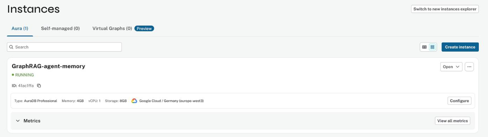
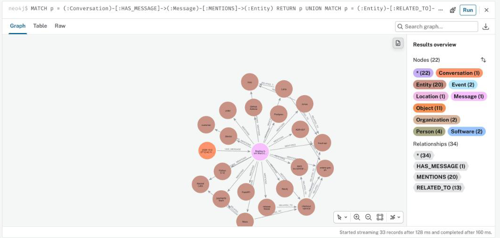
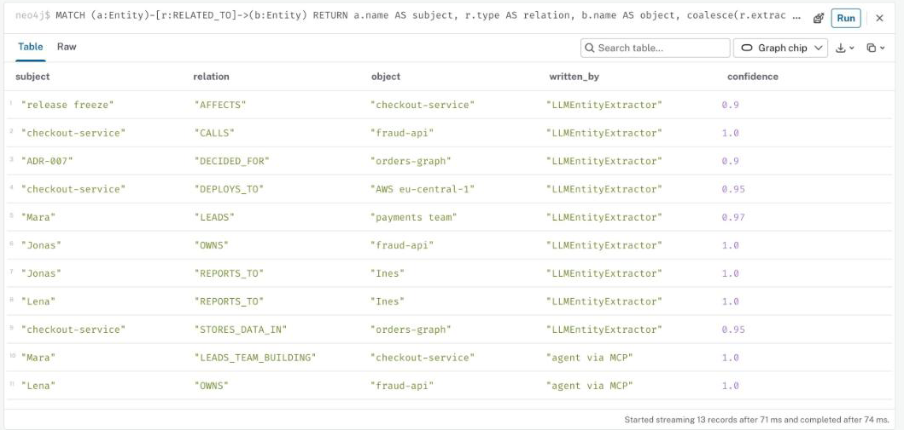

# Setup 1: Neo4j Labs Agent Memory on Neo4j Aura

The open-source SDK [`neo4j-agent-memory`](https://neo4j.com/labs/agent-memory/) (Neo4j Labs, v0.7.0) with its own MCP
server, storing Claude Code's memory **in your own Aura instance** over Bolt. Extraction is driven by the shared
ontology in [ontology/](../ontology/). About 15 minutes.

| Link | What |
|---|---|
| [neo4j.com/labs/agent-memory](https://neo4j.com/labs/agent-memory/) | SDK docs (memory types, MCP tools, ontology-driven extraction) |
| [github.com/neo4j-labs/agent-memory](https://github.com/neo4j-labs/agent-memory) | SDK source |
| [console.neo4j.io](https://console.neo4j.io) | Aura console (instances, Query, Dashboards) |
| [Live dashboard](https://console.neo4j.io/projects/326809f3-c351-4eb7-8770-fcf5d0b6adc1/studio/dashboards/5liMFJOPMbPfXN4fxBwy) | "Agent Memory on Neo4j Aura" (project members only) |

## Step 1: an Aura instance

Aura console → **Instances** → **Create instance** (AuraDB Free is enough) → download the credentials. The demo uses
`GraphRAG-agent-memory` (AuraDB Professional, Google Cloud europe-west3), which also holds the
[haystack-workshop](https://github.com/ma3u/haystack-workshop) GraphRAG data; the SDK's labels (`Entity`, `Message`,
`Conversation`, `Fact`, ...) do not collide with it.



## Step 2: install

```bash
git clone https://github.com/ma3u/neo4j-aura-agent-memory-demo && cd neo4j-aura-agent-memory-demo
python3.12 -m venv venv && venv/bin/pip install -r requirements.txt   # neo4j-agent-memory[mcp,nams,litellm,sentence-transformers]==0.7.0
cp .env.example .env    # NEO4J_URI / NEO4J_USERNAME / NEO4J_PASSWORD from step 1, plus Azure OpenAI (or OpenAI)
```

## Step 3: the ontology

```bash
venv/bin/neo4j-agent-memory ontology validate ontology/agent-memory-software-team.json
# ✓ Ontology 'Agent Memory + Software Team' is valid.  14 entity types, 29 relationship patterns
```

The NAMS "Agent Memory" template plus `Service`, `Team`, `Decision` and `OWNS`, `REPORTS_TO`, `CALLS`, `DEPLOYS_TO`, ...
([ontology/README.md](../ontology/README.md)). The SDK uses it for extraction: only relations that match a pattern are
kept, entities are resolved against existing ones.

## Step 4: start the SDK's MCP server

[bin/agent-memory-mcp](../bin/agent-memory-mcp) loads `.env` and runs

```bash
neo4j-agent-memory mcp serve --backend bolt --uri $NEO4J_URI --user $NEO4J_USERNAME --password ... \
  --llm azure/gpt-5-mini --embedding BAAI/bge-small-en-v1.5 --profile extended
# + NAM_SCHEMA_CONFIG__ONTOLOGY_PATH=ontology/agent-memory-software-team.json
# + LITELLM_DROP_PARAMS=true  (the SDK sends temperature=0.0, which gpt-5-mini rejects; without it extraction fails)
```

LLM: entity/relation extraction and reflections (Azure OpenAI through LiteLLM, or `openai/...`). Embeddings: a local
sentence-transformers model, no key needed. The first start creates the SDK's constraints and indexes in Aura.

## Step 5: connect Claude Code

[.mcp.json](../.mcp.json) declares the server as `agent-memory` (stdio). Open Claude Code in the repo folder, approve the
project MCP servers, then `/mcp` shows **agent-memory: connected, 16 tools**: `memory_store_message`, `memory_add_entity`,
`memory_create_relationship`, `memory_add_fact`, `memory_add_preference`, `memory_search`, `memory_get_context`,
`memory_get_entity`, `memory_get_conversation`, `memory_get_observations`, `memory_list_sessions`, `memory_start_trace`,
`memory_record_step`, `memory_complete_trace`, `memory_export_graph`, `graph_query`.


_(Rendered from the headless run's transcript, [demo/transcripts/aura/day-3.md](../demo/transcripts/aura/day-3.md).)_

Elsewhere (any folder): `claude mcp add agent-memory -s user -- /path/to/repo/bin/agent-memory-mcp`.

## Step 6: talk to it, then look at Aura

Tell Claude Code something worth remembering (or run the scripted story:
`venv/bin/python demo/run_sessions.py --backend aura`). In Aura console → **Query**:

```cypher
MATCH p = (:Conversation)-[:HAS_MESSAGE]->(:Message)-[:MENTIONS]->(:Entity) RETURN p
UNION
MATCH p = (:Entity)-[:RELATED_TO]->(:Entity) RETURN p
```



Which relations came from ontology-driven extraction and which the agent added itself:

```cypher
MATCH (a:Entity)-[r:RELATED_TO]->(b:Entity)
RETURN a.name AS subject, r.type AS relation, b.name AS object,
       coalesce(r.extractor, 'agent via MCP') AS written_by, r.confidence AS confidence
ORDER BY written_by, relation
```



## Step 7: dashboard and eval

```bash
venv/bin/python eval/eval_memory.py --variants no_memory haystack_aura claude_code_aura   # results -> Aura
venv/bin/python dashboard/build_dashboard.py    # -> dashboard/aura_dashboard.json
```

Aura console → **Dashboards** → **Import** → paste `dashboard/aura_dashboard.json`.


Two manual steps after the import (NeoDash bar charts take one value column): "Accuracy per question type" → Settings →
Value: add the other three types; "Relationship types" → Value: add `agent` (stacked).


## Known limits (SDK 0.7.0)

- **No retire/delete for relations over MCP.** A correction adds `Lena OWNS fraud-api`; `Jonas OWNS fraud-api` stays
  live. Facts carry `valid_from`, relationships have `valid_until`, but no MCP tool sets it.
- **Direction is lost when reading relations back** on Bolt: `get_related_entities` matches `-[:RELATED_TO]-` both ways
  and sets `source_id` to the queried entity. The demo's Haystack tool prints relations undirected.
- `graph_query` (raw read-only Cypher) can read everything in the database, not only memory. The demo disables it.
