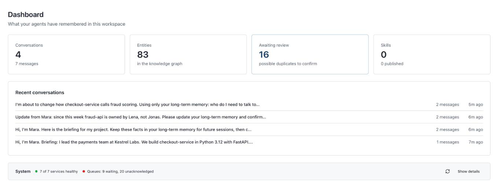
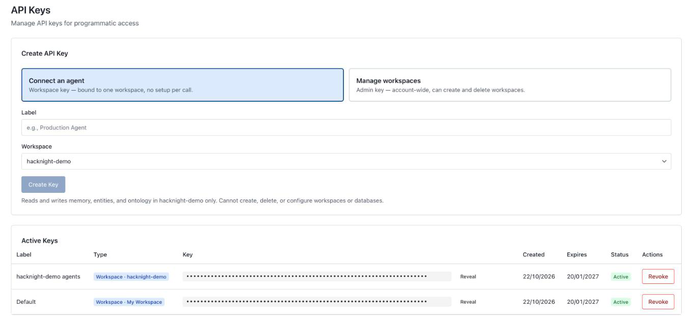
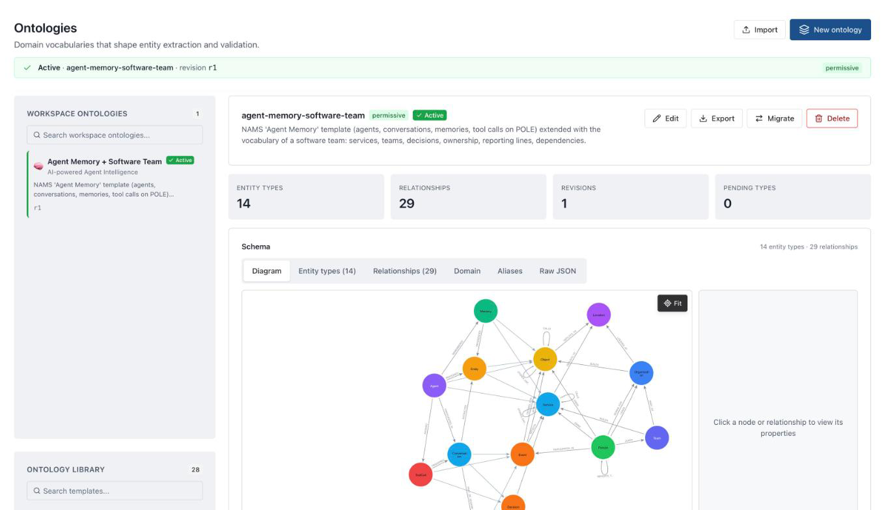
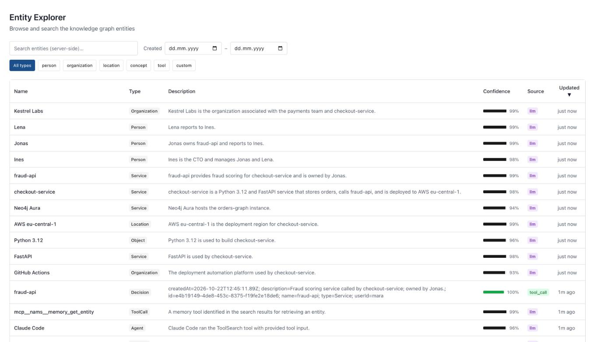
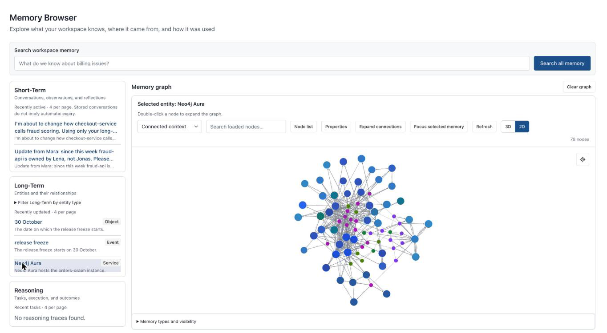

# Setup 2: Neo4j Agent Memory Service (NAMS)

The hosted service [memory.neo4jlabs.com](https://memory.neo4jlabs.com): a workspace with its own (managed Aura) graph,
REST API, a hosted MCP server with 47 tools, background extraction, entity resolution and a console. Claude Code connects
through the hosted MCP server and, optionally, the `nams-hooks` plugin. About 10 minutes.

| Link | What |
|---|---|
| [memory.neo4jlabs.com](https://memory.neo4jlabs.com) | sign in, console |
| [memory.neo4jlabs.com/docs](https://memory.neo4jlabs.com/docs) | Quick Start, Plugins, REST API, MCP Tools, Graph Schema |
| [github.com/neo4j-labs/nams-plugins](https://github.com/neo4j-labs/nams-plugins) | `nams-hooks` for Claude Code, Gemini CLI, Codex, OpenCode |

## Step 1: sign in and create a workspace

[memory.neo4jlabs.com](https://memory.neo4jlabs.com) → **Sign In**. Sidebar → **New workspace** (the demo uses
`hacknight-demo`) → **Provision Free Database** (ready in under a minute; *free databases are removed after 2 days of
inactivity*) or **Bring Your Own Database** (e.g. your Aura instance, for permanent storage). Close the dialog; the
credentials file it downloads is only needed for direct Bolt access.

The workspace dashboard after the demo story (4 conversations, 83 entities, 16 possible duplicates awaiting review):



## Step 2: an API key (for scripts and headless runs)

**API Keys** → **Connect an agent** (workspace key, bound to one workspace) → label → **Create Key** → copy it into
`.env` as `NAMS_API_KEY=nams_...`. Keys expire after 90 days. Interactive Claude Code can use OAuth instead (step 4).



## Step 3: the ontology

Without a workspace ontology NAMS uses its built-in `nams-default` (permissive). To use the same ontology as the Aura
setup: **Ontologies** → **Import** / **New ontology** and paste
[ontology/agent-memory-software-team.json](../ontology/agent-memory-software-team.json), then **Activate**. Or through the
API (what the demo did):

```bash
curl -X POST https://memory.neo4jlabs.com/v1/ontologies -H "Authorization: Bearer $NAMS_API_KEY" \
  -H "Content-Type: application/json" \
  -d "{\"ontology\": $(cat ontology/agent-memory-software-team.json), \"validation_mode\": \"permissive\"}"
# -> {"id": "ov_...", ...}   then:
curl -X POST https://memory.neo4jlabs.com/v1/ontologies/active -H "Authorization: Bearer $NAMS_API_KEY" \
  -H "Content-Type: application/json" -d '{"version_id": "ov_..."}'
```



## Step 4: connect Claude Code

**MCP (explicit tools).** [.mcp.json](../.mcp.json) declares `nams` as an HTTP server with OAuth, no key in the file:

```json
"nams": { "type": "http", "url": "https://memory.neo4jlabs.com/mcp" }
```

Open Claude Code in the repo folder, approve the server, `/mcp` → `nams` → **Authenticate** → sign in, allow the scopes.
NAMS → API Keys → *Connected MCP applications* then lists Claude Code. For headless runs with the key instead:
[demo/nams-mcp.json](../demo/nams-mcp.json) (`Authorization: Bearer ${NAMS_API_KEY}`). Elsewhere:
`claude mcp add --transport http -s user nams https://memory.neo4jlabs.com/mcp`.

**Hooks (automatic capture + recall).** Enabled for this repo in [.claude/settings.json](../.claude/settings.json):

```bash
claude plugin marketplace add neo4j-labs/nams-plugins@latest --scope project
claude plugin install nams-hooks@nams-plugins --scope project
# in Claude Code: /plugin configure nams-hooks@nams-plugins   (API key)  ->  /reload-plugins
```

The hooks store every prompt, answer and tool call, and inject recalled memory into each new prompt. With hooks alone
Claude does not know it has memory ("I couldn't save that"): use hooks **and** the MCP tools.


_(Rendered from the headless run's transcript, [demo/transcripts/nams/day-3.md](../demo/transcripts/nams/day-3.md). Day 3 answers Jonas: the stale owner, see Known limits.)_

## Step 5: talk to it, then look at the console

Scripted: `venv/bin/python demo/run_sessions.py --backend nams`. Then in the console:

- **Entity Explorer**: extracted entities with type, description, confidence, source (LLM / alias)
- **Memory Browser**: the graph
- **Conversations**: every session the hooks stored
- **Entity Resolution Review**: duplicates waiting for a decision (human in the loop)





## Step 6: eval

```bash
venv/bin/python eval/eval_memory.py --variants haystack_nams claude_code_nams
```

The Haystack variant reads the workspace through the same SDK as the Aura setup (`MemorySettings(backend="nams")`).

## Known limits

- No delete/retire for relations over MCP; corrections pile up next to the old fact until entity resolution or review.
- In the SDK's NAMS backend, message search and `get_context` are conversation-scoped, and long-term `get_context`
  returns `""` by design: cross-session recall goes through entity search.
- During an eval the hooks must be off: otherwise each question and answer is stored and becomes memory for the next one.
